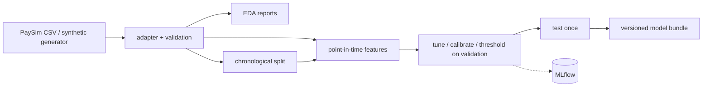

# RiskStream

Real-time fraud detection and risk scoring platform built with traditional
machine learning. The goal is the full lifecycle of a production ML system:
data pipeline, point-in-time features, model development, serving,
streaming, monitoring, retraining and safe deployment.

**Status:** Phases 0-2 are implemented (data pipeline, feature engineering,
model experimentation). Serving, streaming, monitoring and deployment are not
built yet; see [Roadmap](#roadmap).

> Data note: PaySim is a simulation of mobile-money transactions, and the
> project's synthetic generator is simpler still. No result here describes
> performance on real payment fraud.

## Contents

- [What exists today](#what-exists-today)
- [Setup](#setup)
- [Running the pipeline](#running-the-pipeline)
- [Datasets](#datasets)
- [Methodology](#methodology)
- [Results](#results)
- [Tests](#tests)
- [Project layout](#project-layout)
- [Roadmap](#roadmap)
- [Limitations](#limitations)

## What exists today



| component | module |
|---|---|
| configuration (env + YAML) and structured logging | `riskstream.config`, `riskstream.logging_config` |
| canonical schema and dataset adapters | `riskstream.data.schema`, `riskstream.data.adapters` |
| validation with quarantine of bad rows | `riskstream.data.validation`, `riskstream.data.ingestion` |
| deterministic synthetic generator | `riskstream.data.synthetic_generator` |
| EDA report pipeline | `riskstream.data.eda` |
| chronological split | `riskstream.data.splitting` |
| feature registry, offline/online computation, parity | `riskstream.features` |
| estimators, metrics, calibration, cost policy, artifacts | `riskstream.models` |
| tuning and training pipeline with MLflow | `riskstream.training` |
| CLI | `riskstream.cli` |

Details: [docs/ml_pipeline.md](docs/ml_pipeline.md),
[docs/data_dictionary.md](docs/data_dictionary.md),
[docs/decisions/](docs/decisions/).

## Setup

Requirements: Python 3.11+ (developed on 3.14.3, Windows 11). Docker is not
needed yet.

```powershell
python -m venv venv
venv\Scripts\activate                      # macOS/Linux: source venv/bin/activate
python -m pip install -r requirements.txt  # or requirements-lock.txt for exact versions
python -m pip install -e . --no-deps       # makes `riskstream` importable
copy .env.example .env                     # macOS/Linux: cp .env.example .env
```

Environment variables (`.env`): `ENVIRONMENT`, `LOG_LEVEL`, `LOG_FORMAT`
(`text` or `json`), `RANDOM_SEED`, optional `MLFLOW_TRACKING_URI` (default:
`sqlite:///mlflow.db` in the project root). Pipeline settings live in
`configs/*.yaml`.

On Windows, set `$env:PYTHONIOENCODING="utf-8"` if a console shows encoding
errors when printing tables.

## Running the pipeline

Synthetic path (no download, under a minute):

```powershell
python -m riskstream.cli generate-synthetic
python -m riskstream.cli prepare-data --dataset synthetic
python -m riskstream.cli build-features --dataset synthetic
python -m riskstream.cli train --dataset synthetic --n-trials 1
```

PaySim path:

```powershell
python -m riskstream.cli prepare-data --dataset paysim    # ~42 s
python -m riskstream.cli build-features --dataset paysim  # ~36 s
python -m riskstream.cli train --dataset paysim           # ~17 min
python -m riskstream.cli tune-policy --dataset paysim     # ~10 s, thresholds only
python -m mlflow ui --backend-store-uri sqlite:///mlflow.db
```

Times were measured on an AMD Ryzen 5 3550H laptop (8 threads, 5.9 GB RAM).

Outputs:

| path | content |
|---|---|
| `data/interim/<ds>/` | validated canonical Parquet, rejected rows, manifest with raw SHA-256 |
| `reports/eda/<ds>/` | `validation_report.md`, `eda_summary.md`, `eda_report.json`, figures |
| `data/processed/<ds>/splits/` | `train/val/test.parquet`, `split_summary.json` |
| `data/processed/<ds>/features/v1.0.0/` | feature tables, `feature_schema.json`, `feature_manifest.json` |
| `reports/model_evaluation/<run>/` | `report.md`, `results.json`, PR, calibration and importance plots |
| `models/candidates/<run>-<model>/` | model bundle |

## Datasets

**PaySim** ([Kaggle](https://www.kaggle.com/datasets/ealaxi/paysim1)): download
`PS_20174392719_1491204439457_log.csv` (Kaggle login required) and place it at
`data/raw/paysim/`. The pipeline only reads that file. Verified properties:
6,362,620 rows, 0 missing values, 0 duplicate rows, 743 hourly steps,
8,213 fraud rows (0.1291%), fraud only in TRANSFER and CASH_OUT.

**Synthetic** (`riskstream.data.synthetic_generator`): seeded generator that
writes PaySim's raw format, so it goes through the same pipeline. Use it for
tests, CI and demos. Its fraud comes from a few hand-written rules, so model
scores on it mean nothing.

**IEEE-CIS**: not implemented. It would need its own adapter, because its
columns share nothing with PaySim.

## Methodology

* **Validation**: structural checks fail the dataset; row-level violations are
  quarantined to `rejected.parquet` with a reason; known PaySim balance
  inconsistencies are measured but not rejected.
* **Split**: by `step` at 595 and 669, putting about 80/10/10% of fraud cases
  in train/val/test. Row shares are 98.1/0.8/1.1% because PaySim's volume
  collapses late in the month ([ADR 0002](docs/decisions/0002-chronological-split-boundaries.md)).
* **Features** (34, version 1.0.0): transaction features, origin-balance
  features, and destination-account behavior over 24 h and 168 h windows,
  computed point-in-time from earlier hours only. One set of formulas serves
  both offline and online paths, checked by a parity test
  ([ADR 0003](docs/decisions/0003-point-in-time-features.md)).
* **Leakage**: post-transaction balances, the destination's balances and the
  simulator's `isFlaggedFraud` rule are excluded
  ([ADR 0004](docs/decisions/0004-leakage-exclusions-and-balance-ablation.md)).
* **Imbalance, calibration, thresholds**: training-only 10% undersampling of
  legitimate rows, tuned class weights, validation-fitted calibration, and
  APPROVE/REVIEW/DECLINE thresholds that minimize a configurable cost
  ([ADR 0005](docs/decisions/0005-imbalance-calibration-thresholds.md)).
* **Selection**: highest validation PR-AUC. The test set is read once, for the
  selected candidate.

## Results

First PaySim run, `reports/model_evaluation/20261120113918-paysim/report.md`:

| model | validation PR-AUC |
|---|---:|
| LightGBM (selected; test PR-AUC 1.0000) | 0.9999 |
| Logistic regression | 0.9997 |
| XGBoost | 0.9996 |
| Random forest | 0.9996 |
| Decision tree | 0.9988 |
| LightGBM without balance features (ablation) | 0.6222 |
| Isolation Forest (anomaly score) | 0.0268 |

On the test period the selected model flagged all 838 fraud rows, with 62
false positives among 67,688 legitimate rows.

These scores reflect a simulator artifact, not detection skill: in 97.82% of
PaySim fraud rows the amount equals the sender's entire balance, which almost
never happens for legitimate rows. Without balance features, PR-AUC falls to
0.62. See [docs/ml_pipeline.md](docs/ml_pipeline.md#how-to-read-these-numbers)
for this and other caveats.

Decision thresholds are tuned separately from the model with
`python -m riskstream.cli tune-policy --dataset paysim` (no retraining). With
the current cost assumptions, 0.11% of validation payments go to REVIEW and
1.62% are declined.

To reproduce: run the PaySim commands above. Hyperparameter sampling, data
sampling and model seeds are fixed. Multi-threaded LightGBM/XGBoost training
is not guaranteed to be bit-identical across machines.

## Tests

```powershell
python -m pytest tests -q                # all tests, ~40 s
python -m pytest tests -q -m "not slow"  # skip the end-to-end training test
python -m ruff check src tests
```

| suite | covers |
|---|---|
| `tests/unit` | adapter mapping, every validation rule, duplicate handling, tolerance, ordering, synthetic generator determinism, EDA counts, split boundaries and disjointness |
| `tests/feature_parity` | window boundaries, same-step exclusion, no future leakage, labels never affect features, std/z-score math, offline vs. online parity, duplicate events, pruning |
| `tests/model` | metrics on hand-computed examples, cost policy, threshold optimizer, calibration, every estimator with NaN input, bundle round-trip and schema check, end-to-end training that reads test exactly once |

All tests use generated or hand-built data; none need the PaySim file.

## Project layout

```
configs/           data.yaml, features.yaml, model.yaml, thresholds.yaml
src/riskstream/    config, logging_config, cli
  data/            schema, adapters/, validation, ingestion, synthetic_generator, eda, splitting
  features/        registry, derive, offline, online, parity
  models/          estimators, evaluation, calibration, artifacts
  training/        tuning, pipeline
tests/             unit/, feature_parity/, model/
docs/              ml_pipeline.md, data_dictionary.md, decisions/
scripts/           generate_data_dictionary.py
data/, reports/, models/, mlruns/   generated (git-ignored)
```

## Roadmap

| phase | scope | status |
|---|---|---|
| 0 | workspace inspection, plan | done |
| 1 | config, logging, synthetic data, ingestion, validation, EDA, split | done |
| 2 | features, six model families + anomaly detector, tuning, calibration, thresholds, MLflow, artifacts | done |
| 3 | FastAPI inference service, PostgreSQL, decision policy | next |
| 4 | Redis online features, Redpanda streaming, replay | pending |
| 5 | Docker Compose environment | pending |
| 6 | Prometheus, Grafana, alerting | pending |
| 7 | drift, delayed labels, retraining with Prefect, champion/challenger | pending |
| 8 | shadow and canary deployment, rollback | pending |
| 9 | load testing, scaling, failure injection | pending |
| 10 | AWS with Terraform (only with explicit approval) | pending |
| 11 | CI/CD and hardening | pending |

## Limitations

* PaySim is synthetic; its fraud is easy to separate through the balance
  artifact. Results do not transfer to real data.
* Validation and test contain 804 and 838 fraud rows, so metric differences
  between strong models are within noise.
* The costs in `configs/thresholds.yaml` are assumptions, not business figures.
  Policies are therefore written as `unapproved`
  ([ADR 0006](docs/decisions/0006-decision-policy.md)).
* The MLflow model registry is not used yet; bundles are saved to
  `models/candidates/`. Registration and promotion arrive in Phase 7.
* Model bundles are pickles: load them only from trusted locations, with the
  library versions in `requirements-lock.txt`.
