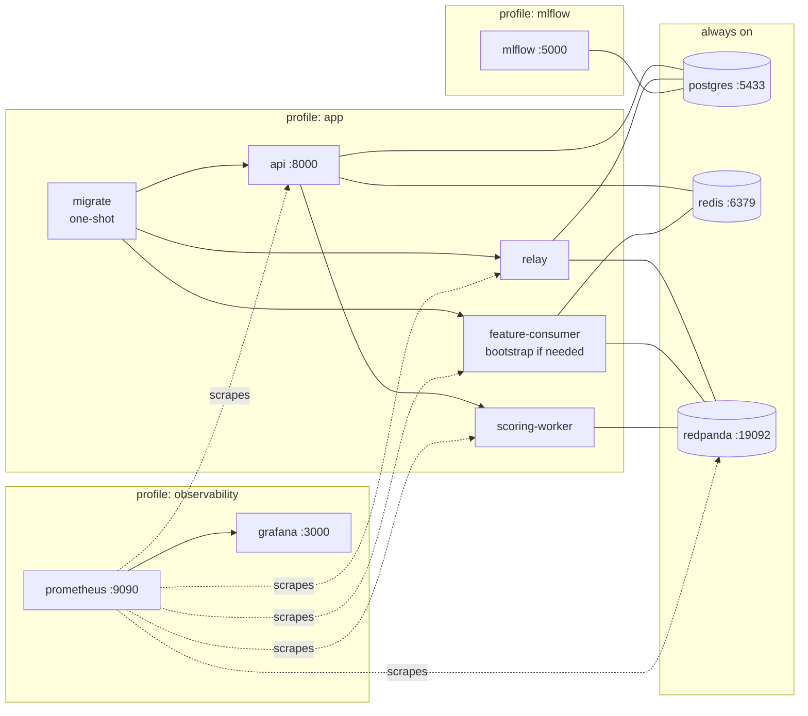

# Local environment (Phase 5)

Everything runs in Docker Compose on one machine. Nothing needs AWS or other
cloud credentials.



## Prerequisites

* Docker Desktop running. The Docker VM on the development laptop has 2.8 GB.
* `.env` filled in (copy `.env.example`; every `change-me` value needs a real
  one). The compose file reads passwords, `API_KEYS`, `WORKER_API_KEY`,
  `MODEL_BUNDLE_PATH` and `POLICY_PATH` from it.
* A trained model bundle and policy under `models/`, mounted read-only into the
  containers. Produce them with `train` and `tune-policy` (README).
* For behavioral features: history loaded into PostgreSQL (`seed-history`).
  The API works without it, but every account then looks new.

The laptop has about 1 GB of free RAM. Close other applications, and start
only the profiles you need.

## Commands

```powershell
docker compose build                                   # the riskstream image (api, workers, jobs, mlflow)

docker compose --profile app up -d                     # infrastructure + application
docker compose --profile observability up -d           # + Prometheus, Grafana
docker compose --profile mlflow up -d                  # + MLflow tracking server / registry
docker compose --profile app --profile observability --profile mlflow ps

docker compose logs -f api feature-consumer            # JSON logs
docker compose --profile "*" stop                      # stop, keep containers and data
docker compose --profile "*" down                      # remove containers, keep volumes
docker compose --profile "*" down -v                   # ALSO deletes PostgreSQL, Redpanda, MLflow, Grafana data
```

Database migrations run automatically (`migrate`). To run one by hand:
`docker compose run --rm migrate`.

Host tools (replay, demo, verification commands) keep working from the venv,
because every service port is published on `127.0.0.1`. See `docs/streaming.md`.

| URL | what |
|---|---|
| http://127.0.0.1:8000/docs | API (key in `secrets/demo_api_key.txt`) |
| http://127.0.0.1:8000/health/ready | readiness incl. online features |
| http://127.0.0.1:9090/targets | Prometheus scrape targets |
| http://127.0.0.1:3000 | Grafana (user `admin`, password `GRAFANA_ADMIN_PASSWORD` in `.env`) |
| http://127.0.0.1:5000 | MLflow |

## Start-up order and self-healing

| service | starts after | on failure |
|---|---|---|
| migrate | postgres and redpanda healthy | exits non-zero, dependants do not start |
| api | migrate completed, redis healthy | restart; readiness 503 until model + database are OK |
| relay | migrate completed | restart |
| feature-consumer | migrate completed, redis healthy | runs `online-bootstrap --if-needed`, then consumes |
| scoring-worker | api healthy | restart |

**Redis restart:** Redis keeps no data on disk. When it comes back empty, the
API falls back to PostgreSQL features. The feature consumer sees
`not_bootstrapped`, exits with code 3 after committing its offsets, and is
restarted. It then rebuilds the store from PostgreSQL and resumes from the last
committed offset. A Redis lock prevents two rebuilds at once. If an operator
runs `online-bootstrap` by hand, the container waits for it instead of
starting a second rebuild.

## Container design

* One image for every Python process. It uses the same locked dependencies as
  the venv, except `xgboost-cpu` replaces `xgboost` (which pulls ~300 MB of
  CUDA libraries on Linux) and Windows-only `pywin32` is dropped.
* Runs as a non-root user (uid 10001), with `init: true` for signal handling.
  `stop_grace_period: 20s` lets consumers finish the current message and
  commit offsets on `docker compose stop`.
* Containers use service names (`postgres:5432`, `redis:6379`, `redpanda:9092`,
  `api:8000`). The host uses the published ports in `.env`.
* `LOG_FORMAT=json` in containers. Worker metrics bind to `0.0.0.0` inside the
  container, but are only reachable on the Compose network, so their ports are
  not published.
* Memory limits: `api` 768m, `feature-consumer` 1536m (the bootstrap runs
  there), the other workers 384m, `mlflow` 512m, `prometheus` and `grafana`
  384m each.

## MLflow

The tracking server stores runs and the model registry in the PostgreSQL
database `mlflow` (owned by `riskstream_owner`), and artifacts in the
`mlartifacts` volume. Clients upload and download artifacts through the
server (`--serve-artifacts`), so no shared filesystem is needed. `.env` sets
`MLFLOW_TRACKING_URI=http://127.0.0.1:5000`, so `train` on the host logs to
it.

Runs from before Phase 5 stay in the local `mlflow.db` / `mlruns/`. View them
with `python -m mlflow ui --backend-store-uri sqlite:///mlflow.db --port 5001`.

## Prometheus and Grafana

Prometheus scrapes the API, the three workers and Redpanda every 15 s
(`infrastructure/prometheus/prometheus.yml`) and keeps 7 days of data. Grafana
is provisioned with the Prometheus data source. Dashboards and alert rules are
Phase 6. Redis and PostgreSQL exporters are not added yet.
