# ML pipeline (Phases 1-2)

```mermaid
flowchart LR
    raw["data/raw/paysim/*.csv<br/>(read only)"] --> adapter["PaySimAdapter<br/>canonical schema"]
    syn["synthetic generator<br/>(seeded)"] --> adapter
    adapter --> val["validation<br/>structural / row / info"]
    val -->|valid rows| interim["data/interim/&lt;ds&gt;/transactions.parquet"]
    val -->|rejected rows + reason| rej["rejected.parquet"]
    interim --> eda["EDA<br/>reports/eda/&lt;ds&gt;/"]
    interim --> split["chronological split<br/>train / val / test"]
    interim --> feats["point-in-time features<br/>offline primitives + derive"]
    split --> feats
    feats --> tables["features/v1.0.0/<br/>train, train_sampled, val, test"]
    tables --> train["tune on train_sampled<br/>score on val"]
    train --> cal["calibrate (val, cross-fitted choice)"]
    cal --> th["cost-based thresholds (val)"]
    th --> sel["select by val PR-AUC"]
    sel --> test["evaluate candidate on test (once)"]
    test --> bundle["models/candidates/&lt;version&gt;/"]
    train -.-> mlflow[("MLflow<br/>mlflow.db + mlruns/")]
    test -.-> mlflow
```



## Commands

| step | command | output |
|---|---|---|
| synthetic data | `python -m riskstream.cli generate-synthetic` | `data/synthetic/transactions.parquet` |
| ingest + validate + EDA + split | `python -m riskstream.cli prepare-data --dataset paysim` | `data/interim/paysim/`, `reports/eda/paysim/`, `data/processed/paysim/splits/` |
| features | `python -m riskstream.cli build-features --dataset paysim` | `data/processed/paysim/features/v1.0.0/` |
| training | `python -m riskstream.cli train --dataset paysim` | `reports/model_evaluation/<version>/`, `models/candidates/<version>-<model>/`, MLflow run |
| decision policy | `python -m riskstream.cli tune-policy --dataset paysim` | `models/policies/<model_version>/`, `reports/policy/` |
| experiment UI | `python -m mlflow ui --backend-store-uri sqlite:///mlflow.db` | http://127.0.0.1:5000 |

Replace `paysim` with `synthetic` to run every step on generated data in seconds.

## Data use by split

| split | used for |
|---|---|
| train (steps 1-595) | event history for features; fitting on `train_sampled` (all fraud + 10% of legit) |
| val (596-669) | hyperparameter choice, calibration, thresholds, model selection |
| test (670-743) | one evaluation of the selected candidate, after everything else is fixed |

The training test `tests/model/test_training_pipeline.py` asserts that the
test table is loaded exactly once and last.

## Models

All models use the same feature table. Configuration lives in `configs/model.yaml`.

| model | notes |
|---|---|
| logistic_regression | baseline; median imputation + missing indicators, signed log1p, standard scaling inside the pipeline |
| decision_tree | native NaN handling |
| random_forest | `max_samples=0.25` per tree to fit in laptop memory |
| xgboost | `hist`, native NaN, tuned `scale_pos_weight` |
| lightgbm | native NaN, tuned `scale_pos_weight` |
| lightgbm_no_balance | ablation without origin-balance features; never a candidate |
| isolation_forest | unsupervised, trained on legitimate rows; anomaly score, never a candidate |

## Artifacts

Each candidate bundle contains `model.joblib`, `calibrator.joblib`,
`metadata.json` and `feature_schema.json`. The metadata records model version,
feature list, feature version and schema hash, calibration method, thresholds,
cost matrix, raw-data SHA-256, training row count, timestamp, MLflow run id,
git commit (and whether the tree was dirty) and library versions.
`load_bundle` refuses a bundle whose feature schema hash differs from the
current registry. After saving, the pipeline reloads the bundle and checks that
its validation predictions are bit-for-bit identical.

Bundles are pickled scikit-learn/LightGBM objects. Loading them requires the
library versions in `requirements-lock.txt`, and like any pickle they must
only be loaded from trusted storage.

## Results of the first PaySim run

Run `20261120113918-paysim` (full report:
`reports/model_evaluation/20261120113918-paysim/report.md`). Machine: AMD Ryzen 5
3550H, 8 threads, 5.9 GB RAM, Windows, Python 3.14.3. Total training time was
about 17 minutes. The working tree had uncommitted changes, so rerun after
committing to get a fully traceable run.

| model | val PR-AUC | note |
|---|---:|---|
| lightgbm (selected) | 0.9999 | test PR-AUC 1.0000, test recall 838/838 at 62 false positives in 67,688 legitimate rows |
| logistic_regression | 0.9997 | |
| xgboost | 0.9996 | |
| random_forest | 0.9996 | |
| decision_tree | 0.9988 | |
| lightgbm_no_balance | 0.6222 | ablation; ROC-AUC 0.9695 |
| isolation_forest | 0.0268 | anomaly score; ROC-AUC 0.6913 |

### How to read these numbers

* **The near-perfect scores come from a PaySim artifact.** In 97.82% of fraud
  rows, but 0.00% of legitimate TRANSFER/CASH_OUT rows, the amount equals the
  sender's entire balance. The top LightGBM feature is
  `amount_to_orig_balance`. Without balance features, validation PR-AUC drops
  to 0.62. That ablation is the better indicator of how much the behavioral
  and transaction features contribute. Even the 0.62 reflects a simulator, not
  real fraud.
* **`hour_of_day` ranks high in both LightGBM models.** In PaySim, fraud volume
  is flat over the day while legitimate volume follows a daily cycle, so night
  hours have a much higher fraud rate. This is also a simulator property.
* **Small validation and test sets.** Validation has 804 fraud rows and test
  has 838. Differences in the fourth decimal of PR-AUC between models are noise.
* **Isolation Forest is weak here** (PR-AUC 0.027 vs. prevalence 0.016). PaySim
  fraud does not look unusual on these features without labels.
* **Isotonic calibration can lower PR-AUC slightly** because it merges scores
  into ties. The ablation's best raw trial scored 0.6387 before calibration
  and 0.6222 after.

### Decision policy (fixed after the first run)

The first run used a flat wrong-decline cost of 50, which made REVIEW unused
(the thresholds inside the training report above come from it). The cost now
grows with the payment amount, and thresholds are chosen by a separate
command that does not retrain:

```powershell
python -m riskstream.cli tune-policy --dataset paysim
```

It writes a versioned policy file under `models/policies/` and a report with a
sensitivity table under `reports/policy/`. For the current model, 0.11% of
validation payments go to REVIEW and 1.62% are declined. See
[ADR 0006](decisions/0006-decision-policy.md).
