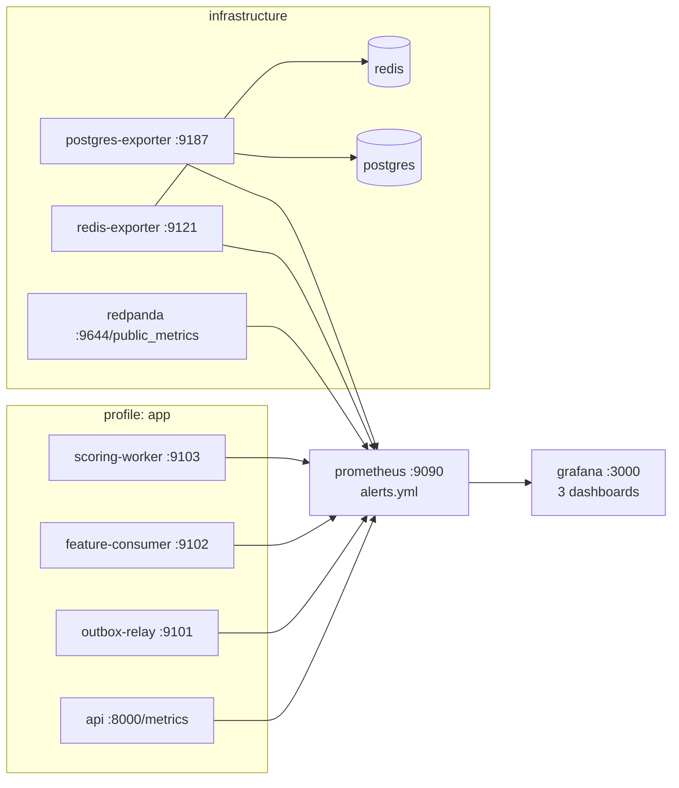

# Monitoring (Phase 6)

Prometheus scrapes every RiskStream process and the infrastructure exporters,
evaluates recording and alert rules, and Grafana shows three provisioned dashboards.
Data drift and labelled model performance are Phase 7; this phase covers service,
pipeline and decision behaviour.



Start it with `docker compose --profile app --profile observability up -d`.

## Files

| File | Purpose |
|---|---|
| `infrastructure/prometheus/prometheus.yml` | scrape jobs; every target has `tier: app` or `tier: infra` |
| `infrastructure/prometheus/alerts.yml` | 4 recording rules, 22 alerts, each with `severity` and `runbook_url` |
| `infrastructure/prometheus/tests/alerts_test.yml` | promtool unit tests; a pytest check makes sure every alert is covered |
| `scripts/build_dashboards.py` | generates `infrastructure/grafana/dashboards/*.json` (do not hand-edit them) |
| `scripts/check_dashboards.py` | runs every panel query and rule against the live Prometheus; checks Grafana provisioning |
| `infrastructure/grafana/provisioning/` | data source (uid `prometheus`) and dashboard file provider (folder RiskStream) |
| `docs/incident_runbooks.md` | one section per alert |

## Metrics

Application metrics are defined in `src/riskstream/monitoring/metrics.py` (API) and
`src/riskstream/monitoring/stream_metrics.py` (relay, consumers, replay). Labels are
bounded: `route` is the route template, never a raw path with ids.

Added in Phase 6:

| Metric | Meaning |
|---|---|
| `riskstream_online_store_usable` | 1 when the API may use Redis features right now |
| `riskstream_online_store_state{reason}` | the freshness verdict; exactly one of 11 fixed reasons is 1 |
| `riskstream_online_store_check_errors_total` | freshness checks that failed during a scrape (Redis unreachable) |
| `riskstream_db_pool_capacity` | pool size + overflow, the denominator for pool saturation |

The freshness gauges are computed at scrape time with the same `assess_freshness`
function the scoring path uses (one Redis `HMGET`), so the dashboard shows the
API's real decision, not a re-implementation of it.

Exporters: `oliver006/redis_exporter:v1.67.0` and
`prometheuscommunity/postgres-exporter:v0.17.1`. postgres-exporter logs in as
`riskstream_monitor` (member of `pg_monitor`, `CONNECTION LIMIT 3`): it can read
statistics views but no table data. Both exporters use a 2 s connection timeout,
below Prometheus' 5 s scrape timeout, so a hung dependency reports `redis_up=0` /
`pg_up=0` instead of making the whole scrape time out (see "Problems found" below).

## Dashboards

| Dashboard | Shows |
|---|---|
| RiskStream / API & Infrastructure | instances up, request rate, 5xx ratio, p50/p95/p99 latency, per-stage latency, in-flight / load shed / rate limited / auth failures, CPU and memory per service, PostgreSQL connections and transactions, API pool, Redis memory and commands, dependency errors, firing alerts |
| RiskStream / Streaming & Online Features | outbox backlog and oldest-event age, published per topic, consumer lag (self-reported and broker-measured), outcomes, scored-to-Redis age, blocked/stalled, dead letters, feature source and fallbacks, current freshness verdict, Redis keys, Redpanda throughput, latency and partitions |
| RiskStream / Model Serving | loaded model and policy versions, decision rate and decline/review share, decisions by model version, fraud-probability heatmap, mean probability, idempotent replays and conflicts, labels, inference latency |

Infrastructure and model behaviour are separate boards. The model board is labelled as a
simulated decision policy on PaySim data.

To change a dashboard: edit `scripts/build_dashboards.py`, run it, commit both. The test
`test_dashboards_match_generator` fails if the JSON is out of date.

## Alerts

| Group | Alerts |
|---|---|
| availability | ServiceDown, InfraExporterDown, PostgresDown, RedisDown, ModelNotLoaded |
| api | ApiHighErrorRate (>5% 5xx, 5m), ApiHighLatency (p95 > 250 ms, 10m), ApiLoadShedding, DatabaseErrors, DbPoolSaturated (>90%, 5m) |
| features | OnlineStoreUnusable (10m), FeatureFallbackHigh (>20%, 10m) |
| streaming | ConsumerBlocked (2m), FeatureConsumerStalled (>60 s), ConsumerLagHigh (>1000, 5m), OutboxBacklogStale (>60 s, 2m), DeadLetters, RedpandaUnavailablePartitions |
| capacity | PostgresConnectionsHigh (>80%), RedisMemoryHigh (>85% of maxmemory), ProcessMemoryNearLimit (~85% of container limit), RedpandaDiskLow |

Thresholds are set from measured local behaviour: `/v1/score` p95 about 40 ms,
scored-to-Redis p95 about 0.9 s, a cold online-store rebuild 2-3.5 min.
There is no Alertmanager locally; alerts are visible at http://127.0.0.1:9090/alerts
and in the *Firing alerts* panel. Notification routing is a deployment concern.

## How it was tested

```powershell
# alert rule unit tests (also run by pytest when Docker is available)
docker run --rm -v "${PWD}\infrastructure\prometheus:/p" --entrypoint promtool prom/prometheus:v3.5.0 test rules /p/tests/alerts_test.yml

# config tests: dashboards up to date, every query/rule uses a known metric,
# every alert has severity + runbook section, exporter timeouts, DB grants, gauges, log fields
python -m pytest tests/unit/test_observability_config.py tests/api/test_observability_metrics.py

# live: all targets, all rules healthy, every panel query, Grafana provisioning
python scripts/check_dashboards.py
```

Live results (2026-11-23, after replaying steps 613-614, 1,323 transactions):

| Check | Result |
|---|---|
| scrape targets | 8 of 8 up (api, outbox-relay, feature-consumer, scoring-worker, redpanda, redis, postgres, prometheus) |
| rules | 26 loaded, 0 unhealthy |
| dashboard queries | 89 queries: 79 return data, 10 empty, 0 errors. Empty ones are counters with no events yet (5xx, auth failures, dependency errors, conflicts, idempotent replays, labels, publish failures, dead letters, fallbacks) and the alert table when nothing fires |
| Grafana | 3 dashboards provisioned in folder RiskStream; data source health OK |
| `/v1/score` p95 | 41 ms (server side, 10 min window) |
| scored -> Redis p95 | 0.91 s |
| feature source | 100% Redis during the replay |
| Redis paused (`docker pause`) | RedisDown fired after 1 min, OnlineStoreUnusable after 10 min (reason `redis_unavailable`); both resolved within 45 s of unpause |
| relay stopped | ServiceDown fired for outbox-relay; freshness reason `relay_heartbeat_stale`; resolved after restart |
| JSON logs | `service`, `instance`, `environment` present in api, relay, feature-consumer, scoring-worker logs |
| memory, all profiles | about 1.6 GB across 12 containers; exporters about 11 MB each |

## Problems found during live verification

1. **postgres-exporter showed `pg_up = 0` with PostgreSQL healthy**: `roles.sql` revokes
   `CONNECT` on the database from `PUBLIC`, and the monitor role was not granted it.
   Fixed with `GRANT CONNECT ON DATABASE riskstream TO riskstream_monitor`; a unit test now
   checks that every non-owner login role has the grant.
2. **A paused Redis did not fire RedisDown.** redis_exporter's default connection timeout
   (15 s) is longer than the scrape timeout (5 s), so the scrape itself failed, `redis_up`
   disappeared, and only InfraExporterDown fired. Fixed with
   `REDIS_EXPORTER_CONNECTION_TIMEOUT=2s` (and `connect_timeout=2` for PostgreSQL); the
   scrape now completes in about 2 s with `redis_up 0`. A unit test checks both timeouts.
3. **The 5xx and fallback ratio series were empty, not 0, without errors.** A labelled counter
   has no series until its first increment, so the numerator was empty. The recording rules
   now use `or vector(0)` on the numerator.

## Dashboard review fixes (2026-11-23)

Found by checking screenshots of the live dashboards against Prometheus, the API logs,
the database and the PaySim file.

| Panel | What it showed | Cause | Fix |
|---|---|---|---|
| `/v1/score p95` | 1.900 s in red while idle | 8 requests (step 615); the first took 1,119 ms, the rest 29-52 ms. With 8 samples, p95 is the slowest request. The stat used a range query with "last not null", so it kept showing that value 10 minutes later | Quantiles are shown only when the window has at least 20 observations, otherwise "no traffic". Stats and tables use instant queries (value now). `ApiHighLatency` also requires at least 0.1 req/s |
| `5xx ratio` | two 0.00% boxes | `rule or vector(0)`: the rule's series keeps its name label, `vector(0)` has none, so before the rule reload Grafana saw two series | `sum(rule) or vector(0)`: always one series |
| Decisions by outcome | looked as if everything was REVIEW | stacked with 10% fill: the top line (REVIEW = 0) is drawn at the total height | not stacked; new panel "Declines and reviews / s" so rare outcomes are not flattened by APPROVE; stacked panels elsewhere use 60% fill |
| ratio and rate panels | axes like 10000% or 100 req/s with all-zero data | Grafana auto-range on a flat series | soft axis 0..1 (rates) or 0..1% (ratios), percent panels capped at 100% |
| Decline / review share | 0.00% with no traffic | divided by `clamp_min(total, 1e-9)` | divide by `(total > 0)`: "no traffic" when nothing was scored, 0% when scored but none declined |

Checked live afterwards: after the 6 transactions of step 616 the p95, share and
scored-to-Redis stats show "no traffic"; during step 617 (2,680 transactions) they show
p95 35 ms, decline share 0.68%, review share 0%, scored to Redis p95 1.31 s.
`check_dashboards.py`: 91 queries, 0 errors. Six new tests in
`tests/unit/test_observability_config.py` guard each fix.

**The 1.1 s first request after idle.** Every stage of that request was slow (idempotency
check, feature derivation, model inference, persist all 60-250 ms) except the Redis read,
so it was not one dependency. The Docker VM has 2.8 GB and was using swap: the API process
had 63 MB swapped out, the relay 41 MB, the scoring worker 30 MB. After 40 idle minutes the
first request paged code and model memory back in. This is a property of the laptop's memory
budget, not a code fault, so no code change was made. Stopping the `mlflow` profile when it
is not needed frees about 400 MB.