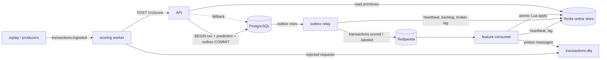

# Streaming and online features (Phase 4)



## Components

| process | command | reads | writes |
|---|---|---|---|
| outbox relay | `run-relay` | `outbox_events` (FOR UPDATE SKIP LOCKED) | topics, `published_at`, relay meta |
| feature consumer | `run-feature-consumer` | `transactions.scored` | Redis (Lua), DLQ |
| scoring worker | `run-scoring-worker` | `transactions.ingested` | `POST /v1/score`, DLQ |
| replay | `replay` | PaySim canonical data | `transactions.ingested` |
| bootstrap | `online-bootstrap` | PostgreSQL snapshot | Redis namespace |

Topics have 6 partitions. Messages are keyed by destination account, so one
account's events stay in one partition and in order.

## Delivery guarantees

| hop | guarantee | how |
|---|---|---|
| decision -> event | exactly one event per stored decision | transaction, prediction and outbox row commit together |
| outbox -> topic | at-least-once | relay marks rows only after broker acks; a crash re-sends the same `event_id` (tested) |
| topic -> consumer | at-least-once | offsets stored after processing, auto-committed from the store |
| consumer -> Redis | effectively once | `event_id` dedup key set inside the same Lua script as the update (7-day TTL) |
| ingested -> API | effectively once | the API is idempotent by `transaction_id` (identical retry returns the stored decision) |

There is no exactly-once across PostgreSQL, Redpanda and Redis. A duplicate
redelivered more than 7 days later would be counted twice.

## Online store layout

See the docstring in `src/riskstream/features/online_store.py`. Lifetime
account stats are packed into 32,768 hashes per role, which Redis stores as
compact listpacks (verified: `OBJECT ENCODING` = listpack, ~220 entries per
hash). Window buckets live in one hash per destination and are pruned by
simulated step on every write. The wall-clock TTL (35 days) is only a safety
net.

Redis runs with `maxmemory-policy noeviction` and no persistence. When it is
full, writes fail loudly and the consumer blocks, instead of features
disappearing. After a Redis restart the store is empty, so the API falls back
to PostgreSQL until `online-bootstrap` runs again (4.6 min for 6.26M rows).

## Consistency model

Features use only completed earlier hours. A transaction's event therefore
matters only to transactions in later hours. With Redis features, a
transaction is included once the relay has published it and the consumer has
applied it. The feature consumer exports that delay as
`riskstream_stream_event_age_seconds`. It has not been benchmarked yet;
Phase 6 dashboards and Phase 9 load tests will measure it.

The API uses Redis only while the pipeline is demonstrably live. Otherwise it
falls back to PostgreSQL, which is slower but uses identical feature
semantics:

| check (`configs/streaming.yaml` -> freshness) | fallback reason |
|---|---|
| store bootstrapped, layout version matches | `not_bootstrapped`, `layout_mismatch` |
| relay and consumer heartbeats younger than 15 s | `relay_heartbeat_stale`, `consumer_heartbeat_stale` |
| consumer not blocked | `consumer_not_running` |
| oldest unpublished outbox event younger than 5 s | `relay_backlog` |
| consumer lag (self-reported and broker-measured) <= 1000 | `consumer_lag` |
| broker lag not stalled for more than 3 s | `consumer_stalled` |
| query not older than the entity's newest applied step, window data present | `late_query`, `window_missing`, `before_window_floor` |
| Redis reachable within 50 ms | `redis_unavailable` |

**Known gap:** a consumer that dies is detected after the stall threshold
(3 s, measured by the relay from the broker) or the heartbeat timeout (15 s),
whichever comes first. In the failure test below, 9 requests in that window
still used Redis. That was correct, because all earlier hours were already
applied. Had an earlier hour still been pending, those requests would have
missed some history. With real time (1 step = 1 hour) this can only happen in
the first seconds of an hour.

`replay --barrier` removes the gap for simulations: it publishes hour h+1
only after every event of hour h is applied.

## Failure handling

| failure | behaviour | verified |
|---|---|---|
| Redis down | API falls back to PostgreSQL, readiness `degraded`, consumer retries then blocks on the same message; on recovery it applies the backlog | live: Redis paused, 865 requests scored with fallback, 0 lost |
| feature consumer killed | API detects stale heartbeat / stalled lag and falls back; restarted consumer resumes from committed offsets | live: killed with `Stop-Process -Force`, 14 pending events applied after restart |
| consumer restart / redelivery | duplicates skipped by `event_id` | integration test + live (12,739 bootstrap events skipped) |
| relay crash before marking | same events re-sent, deduplicated downstream | unit test |
| poison message | sent to `transactions.dlq` with source partition/offset and error; stream continues | live + integration test |
| API 409 / 422 for an ingested event | dead-lettered (retry can never succeed) | unit test |
| API 401 / 403 / 429 / 5xx / unreachable | retried with backoff, then blocked (never dead-lettered) | unit test |

## Commands

```powershell
docker compose up -d postgres redis redpanda
python -m riskstream.cli db-upgrade
python -m riskstream.cli topics-create
python -m riskstream.cli online-bootstrap

# one terminal each
python -m riskstream.cli serve
python -m riskstream.cli run-relay --metrics-port 9101
python -m riskstream.cli run-feature-consumer --metrics-port 9102
python -m riskstream.cli run-scoring-worker --metrics-port 9103

python -m riskstream.cli history-status --dataset paysim      # next step to replay
python -m riskstream.cli replay --dataset paysim --from-step <next> --steps 2 --rate 150 --barrier
python -m riskstream.cli verify-predictions --dataset paysim --from-step <next> --to-step <next+1>
python -m riskstream.cli check-online-store --dataset paysim   # read-only Redis vs PostgreSQL
python -m riskstream.cli stream-status
python -m riskstream.cli dlq-inspect
```
