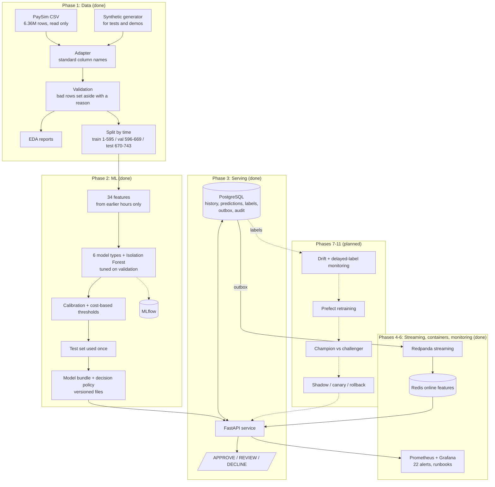

# RiskStream: how the deployed system works

RiskStream is a fraud-checking service that a payment system calls before it
completes a payment. This page describes how the whole system works once it is
deployed, and marks which parts exist today (Phases 0–6) and which are still
planned (Phases 7–11).

## Contents

- [Architecture overview](#architecture-overview)
- [1. Who uses it](#1-who-uses-it)
- [2. The life of one payment](#2-the-life-of-one-payment)
- [3. Background work](#3-background-work)
- [4. Watching it (Phase 6, done)](#4-watching-it-phase-6-done)
- [5. Learning from outcomes (Phase 7, planned)](#5-learning-from-outcomes-phase-7-planned)
- [6. Releasing a new model safely (Phase 8, planned)](#6-releasing-a-new-model-safely-phase-8-planned)
- [7. Where it runs](#7-where-it-runs)
- [8. Status](#8-status)

---

## Architecture overview

Solid arrows are built; dotted arrows are planned.



---

## 1. Who uses it

| User | What they do | API key role |
|---|---|---|
| **Payment system** (a bank or wallet app) | Sends each payment for a decision before completing it | `scorer` |
| **Fraud analysts** | Look up past decisions and work the REVIEW queue | `reader` |
| **Investigations / chargeback system** | Reports later whether a payment really was fraud | `labeler` |
| **Operations / on-call engineer** | Watches the Grafana dashboards and responds to alerts using the runbooks | none |
| **ML team** | Retrains and releases new models | none |

The customer never sees RiskStream. They only notice that their payment went
through, was blocked, or was held for a check.

---

## 2. The life of one payment

```text
Customer pays ──► Payment system ──POST /v1/score──► RiskStream API ──► answer in ~35 ms
                                                          │
                                         stores decision + event (PostgreSQL)
                                                          │
                               outbox relay ──► Kafka ──► feature consumer ──► Redis
                                                                     (account history updated in < 1.5 s)
```

1. **The customer pays.** For example, a TRANSFER of 9,000 from account A to account B.
2. **The payment system asks RiskStream.** It calls `POST /v1/score` with the
   transaction details and its API key.
3. **RiskStream checks the request.** It verifies the key and the request size,
   and applies rate limits. If the same `transaction_id` was already scored, it
   returns the stored answer, so a retry can never create two decisions.
4. **It builds features.** It reads the account's recent behaviour from Redis:
   how many transactions B received in the last 24 hours, how unusual this
   amount is for this account, and so on. If Redis is down or out of date, it
   falls back to computing the same features from PostgreSQL. That path is
   slower but gives identical results.
5. **The model scores the payment.** LightGBM returns a fraud probability, and
   the cost-based policy turns it into a decision:

   | Decision | Effect |
   |---|---|
   | **APPROVE** | the payment goes through |
   | **REVIEW** | the payment is held for an analyst |
   | **DECLINE** | the payment is blocked |

6. **It saves before answering.** The decision, the features used and the model
   version are written to PostgreSQL, together with an "event" row in the same
   database transaction. If the database is down, the API returns 503 rather
   than give an answer it couldn't record ("fail closed").
7. **It answers.** This takes about 35 ms at p95. The payment system then acts
   on the decision.

> That is the part the customer waits for. Everything after this happens in the background.

---

## 3. Background work

- **Outbox relay:** reads the saved events from PostgreSQL and publishes them to
  Kafka (Redpanda locally).
- **Feature consumer:** reads those events and updates the account history in
  Redis. The next payment from the same account therefore sees this one,
  normally within about 1–1.5 s.
- **Dead-letter queue:** a message that can never be processed goes here for
  inspection instead of blocking the pipeline.
- **Self-healing:** if Redis restarts empty, the feature consumer rebuilds it
  from PostgreSQL in about 2–3 minutes without anyone stepping in. Scoring
  continues meanwhile on the PostgreSQL features.

---

## 4. Watching it (Phase 6, done)

- **Prometheus** collects metrics from every service every 15 seconds.
- **Grafana** shows three dashboards: traffic and latency, the streaming
  pipeline, and model decisions.
- **22 alerts** watch for problems, such as Redis being down, the error rate
  going above 5%, a consumer getting stuck, or memory running out. Each alert
  links to a runbook that says how to confirm the problem, how to fix it and
  how to check recovery.

In a real deployment, alerts would also page the on-call engineer through
Slack, PagerDuty or similar. Locally they only appear in Prometheus and Grafana.

---

## 5. Learning from outcomes (Phase 7, planned)

1. **Labels arrive late.** Days or weeks later, a chargeback or an investigation
   confirms that a payment was fraud, and that result is sent to `POST /v1/labels`.
2. **Performance tracking:** RiskStream compares its past decisions with those
   labels and tracks real precision and recall.
3. **Drift monitoring:** Evidently watches whether incoming transactions start
   to look different from the training data, for example new amounts or new patterns.
4. **Retraining:** Prefect runs scheduled or drift-triggered retraining.
5. **Champion/challenger:** a new model has to beat the current one on the same
   data before it can be considered.

---

## 6. Releasing a new model safely (Phase 8, planned)

1. **Shadow:** the new model scores real traffic, but its decisions are only
   recorded, never used.
2. **Canary:** if it does well, it makes real decisions for a small share of
   traffic, such as 5%, while the dashboards compare it with the current model.
3. **Full rollout or rollback:** if anything looks wrong, a rollback switches
   back to the previous model version within minutes.

---

## 7. Where it runs

| Part | Today (your laptop) | Deployed (Phase 10, only with your approval) |
|---|---|---|
| API and workers | Docker Compose containers | Several copies behind a load balancer, e.g. AWS ECS or EKS |
| PostgreSQL | Container | Managed database, e.g. AWS RDS, with backups |
| Redis | Container | Managed Redis, e.g. ElastiCache |
| Kafka | Redpanda container | Managed Kafka, e.g. MSK |
| Monitoring | Prometheus + Grafana containers | Managed Prometheus/Grafana or the same tools hosted |
| Setup | `docker compose up` | Terraform (infrastructure as code); CI/CD deploys each change after tests pass (Phase 11) |

The AWS services in this table are typical choices, not decisions. Nothing will
be created on AWS until you approve it. Phase 9 load tests the system first, to
show how many copies are needed and what happens when parts fail.

---

## 8. Status

| Done | Planned |
|---|---|
| Data, features, model, cost policy (0–2) | Drift, delayed labels, retraining, champion/challenger (7) |
| Scoring API and database (3) | Shadow/canary releases and rollback (8) |
| Streaming and Redis features (4) | Load and failure testing (9) |
| Containers (5) | AWS with Terraform (10) |
| Monitoring and alerts (6) | CI/CD and security hardening (11) |

> **Limitation:** the model is trained on PaySim, which is simulated data. The
> system around it is built the way a production system would be. A real
> deployment would need training on the company's own transactions, and real
> business costs in the decision policy.
